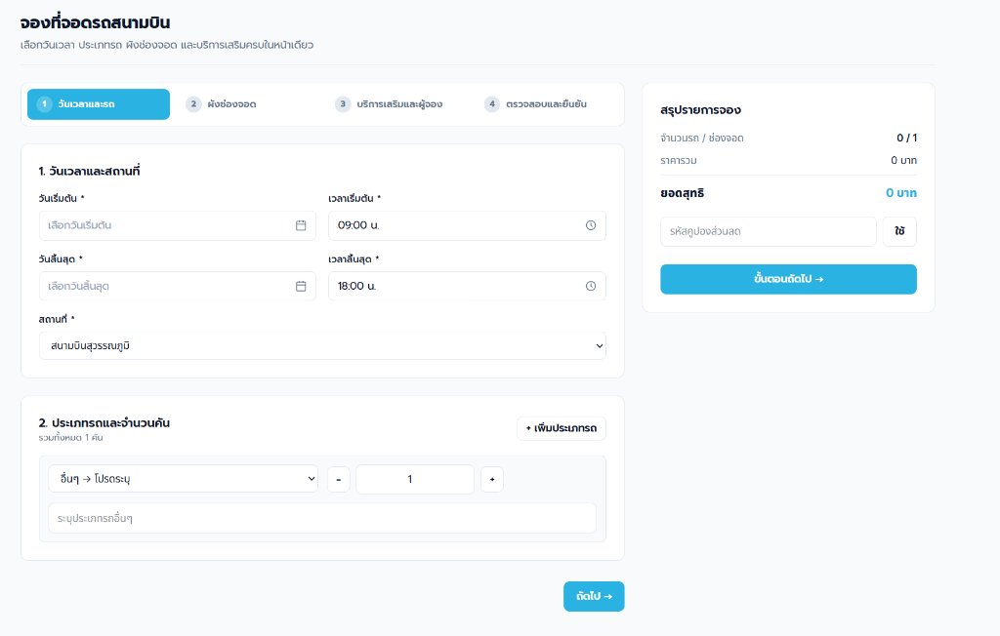
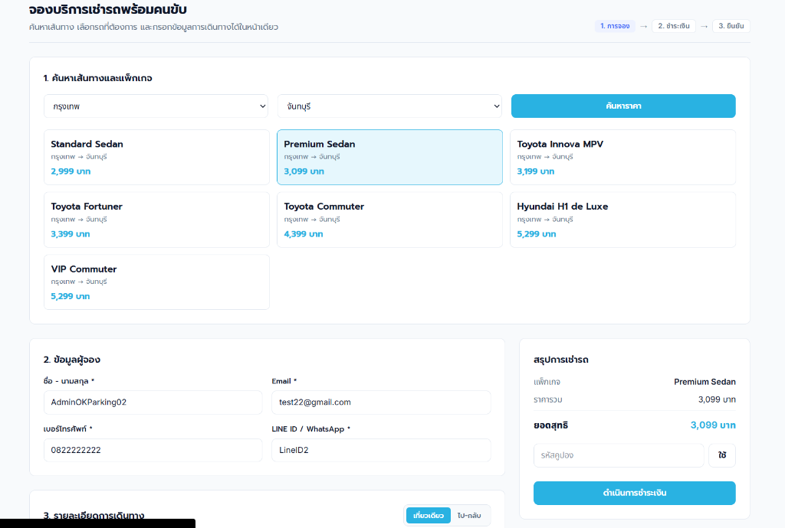

# Parking System (`fluffy-dev`)

ระบบจองที่จอดรถสนามบิน, จองบริการเช่ารถพร้อมคนขับ และระบบสมาชิก/แอดมิน บน WordPress Theme (`fluffy-dev`) พัฒนาด้วย React (`@wordpress/scripts`)

---

## ภาพตัวอย่างหน้าจอ (Screenshots)

### 1. ระบบจองที่จอดรถสนามบิน (4-Step Wizard)
เลือกวันเวลา สถานที่ ประเภทรถ ผังช่องจอด และบริการเสริม พร้อมสรุปราคาและคูปองส่วนลด



### 2. ระบบจองบริการเช่ารถพร้อมคนขับ
ค้นหาเส้นทาง เลือกแพ็กเกจรถ กรอกข้อมูลผู้จอง และดำเนินการชำระเงินได้ในหน้าเดียว



---

## โครงสร้างโปรเจกต์

- `app/public/wp-content/themes/fluffy-dev/` — WordPress Theme + React (`src/react/`)
- `.github/workflows/deploy.yml` — GitHub Actions สำหรับ build React และ deploy ขึ้น FTP เมื่อ push เข้า `main`

## การพัฒนา (Development)

```bash
cd app/public/wp-content/themes/fluffy-dev
npm install
npm run start   # Watch mode
npm run build   # Production build
```
