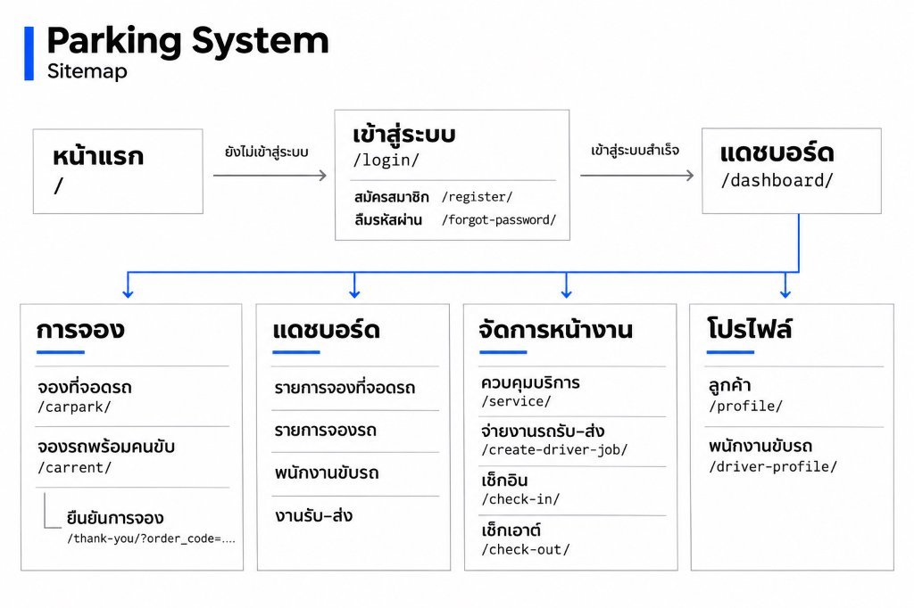
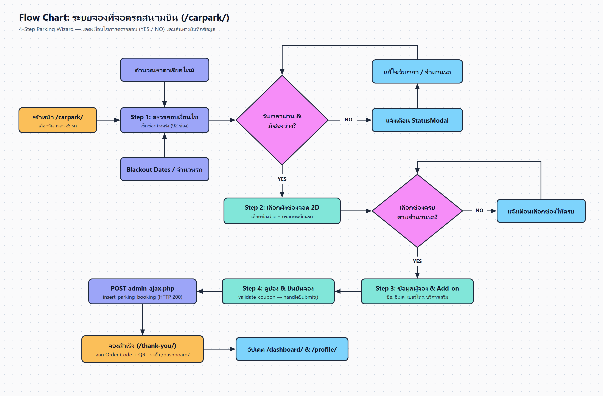
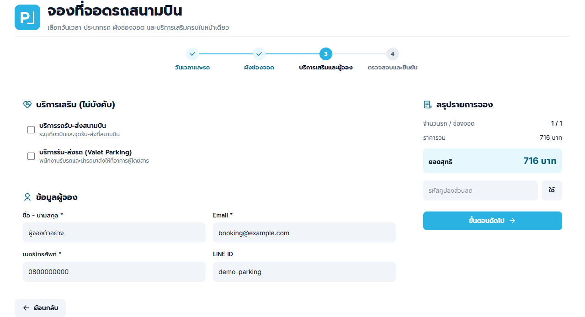
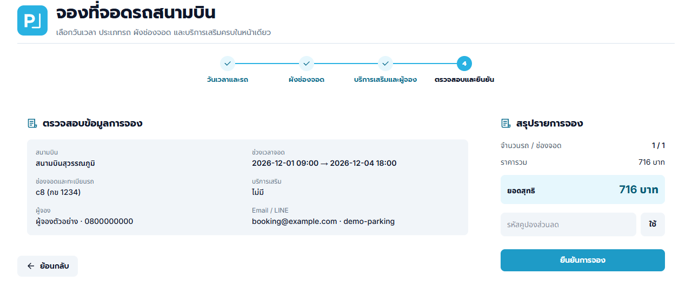

# Parking System (`fluffy-dev`)

ระบบจองที่จอดรถสนามบิน, จองบริการเช่ารถพร้อมคนขับ และระบบสมาชิก/แอดมิน บน WordPress Theme (`fluffy-dev`) พัฒนาด้วย React (`@wordpress/scripts`)


---

## แผนผังระบบและ Flow Chart (Site Map & Architecture)

### ภาพรวมโครงสร้างและเส้นทางหน้าเว็บ (Site Map)


### Flow Chart: ระบบจองที่จอดรถสนามบิน (`/carpark/`)


### Flow Chart: ระบบจองบริการเช่ารถพร้อมคนขับ (`/carrent/`)


---

## คู่มือการใช้งานแบบ Step-by-Step

### 1. ระบบจองที่จอดรถสนามบิน (`/carpark/` — 4-Step Wizard)

#### Step 1: เลือกวันเวลา สถานที่ และประเภทรถ
- กำหนด **วันเริ่มต้น–วันสิ้นสุด** และ **เวลาเริ่มต้น–เวลาสิ้นสุด**
- เลือก **สถานที่จอดรถ** (เช่น สนามบินสุวรรณภูมิ)
- เลือก **ประเภทรถและจำนวนคัน** (สามารถกด `+ เพิ่มประเภทรถ` ได้หลายประเภท) ระบบจะคำนวณราคาให้อัตโนมัติในแถบ **สรุปรายการจอง** ด้านขวา


---

#### Step 2: เลือกช่องจอดและกรอกทะเบียนรถ

- สลับระหว่าง **ผัง** กับ **รายการ** หรือเลือกแท็บแถวที่ต้องการ
- เลือกช่องให้ครบตามจำนวนรถ ระบบจะจัดช่องให้รถแต่ละคันตามลำดับ
- เปิดรายการ **รถของคุณ** เพื่อกรอกทะเบียนแต่ละคัน หรือเลือกทะเบียนที่บันทึกไว้ เมื่อกรอกครบจึงกด **ถัดไป**


---

#### Step 3: เลือกบริการเสริมและกรอกข้อมูลผู้จอง

- เลือกบริการรถรับ–ส่งสนามบินหรือ Valet Parking ตามต้องการ
- กรอกชื่อ เบอร์โทร อีเมล และ LINE ID หากต้องการระบุ ใช้รหัสคูปองได้จากกล่องสรุปรายการจอง



---

#### Step 4: ตรวจสอบและยืนยันการจอง

- ตรวจสอบสนามบิน วันเวลา ช่องจอด ทะเบียน ข้อมูลติดต่อ และยอดสุทธิ ก่อนกด **ยืนยันการจอง**



---

### 2. ระบบจองบริการเช่ารถพร้อมคนขับ (`/carrent/`)
1. **ค้นหาเส้นทางและแพ็กเกจ:** เลือกต้นทาง–ปลายทาง แล้วกด `ค้นหาราคา` เพื่อดูแพ็กเกจรถทั้งหมด (เช่น Standard Sedan, Premium Sedan, Toyota Innova MPV, Toyota Fortuner, VIP Commuter)
2. **กรอกข้อมูลผู้จองและรายละเอียดการเดินทาง:** ระบุชื่อ, อีเมล, เบอร์โทร, LINE ID / WhatsApp, จุดรับ–ส่ง, วันเวลา และเลือกรูปแบบ `เที่ยวเดียว` หรือ `ไป-กลับ`
3. **สรุปและชำระเงิน:** ตรวจสอบราคาใน **สรุปการเช่ารถ** ใส่โค้ดส่วนลด (ถ้ามี) แล้วกด `ดำเนินการชำระเงิน`


---

## โครงสร้างโปรเจกต์

- `app/public/wp-content/themes/fluffy-dev/` — WordPress Theme + React (`src/react/`)
- `.github/workflows/deploy.yml` — GitHub Actions สำหรับ build React และ deploy ขึ้น FTP เมื่อ push เข้า `main`

## การพัฒนา (Development)

```bash
cd app/public/wp-content/themes/fluffy-dev
npm install
npm run start   # Watch mode
npm run build   # Production build
```
